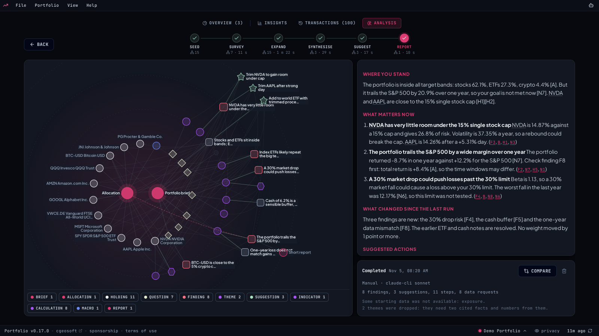

# Portfolio

A private personal investment portfolio tracker for Linux, Windows and macOS built with **Bun**, **bun:sqlite**, **React 19** and **Electrobun**.

Your portfolio data stays strictly on your local device. Market quotes are fetched live from Yahoo Finance, and Guided Analysis and the assistant run through any OpenAI-compatible server or API (llama.cpp, Ollama, LM Studio, OpenAI, Groq, OpenRouter and others) or the Claude and Codex CLIs.

<p align="center">
  
</p>

<p align="center">
  <sub>Guided Analysis on the built-in demo portfolio: the stages of the run, the evidence graph it grew, and the short report that links back to its nodes.</sub>
</p>

---

## Key Features

- **Local Data Storage**: Portfolios, transactions, and snapshots are stored locally in SQLite (`~/.local/share/portfolio/portfolio.sqlite` on Linux). No external server or accounts needed.
- **Local SQLite Engine (`bun:sqlite`)**: High-performance WAL-mode SQLite database with indexed tables and instant queries.
- **Live Market Valuation & Multi-Currency FX**: Real-time quotes, intraday P&L, historical charts, and foreign exchange conversions powered by Yahoo Finance.
- **Progressive Financial Analytics**: Automatic calculation of total invested capital, realized gains, uninvested cash liquidity balance, dividend income, broker fees, and tax withholdings.
- **Sandboxed Metric Modules**: Every metric is a WebAssembly module with a YAML manifest that declares its developer, version, and the data scopes it reads. Modules run in a separate engine process with no file, network, or system access, a memory ceiling, and a time budget. Preferences → Metrics lists the metrics of a portfolio, a bounded dashboard (4 large cards, 6 compact tiles) that feeds the Overview, and a marketplace built from [`extras/metrics/repository.yml`](extras/metrics/README.md). Third-party modules can be installed from a URL after a scope consent dialog and stay marked UNVERIFIED.
- **Technical Indicators**: 50-day and 200-day Simple Moving Averages (SMA 50, SMA 200), 14-day Relative Strength Index (RSI), and 52-week ranges.
- **Broker CSV Importer**: Intelligent CSV and Excel (.xlsx) import wizard with automatic template detection (Trade Republic, Trading 212, Scalable Capital, Interactive Brokers, DEGIRO, eToro, Revolut, XTB, Saxo) with dry-run diff preview and duplicate protection.
- **Guided Analysis**: Write a brief with the purpose and goal of a portfolio. A run grows an evidence graph around it in six stages (seed, survey, expand, synthesise, suggest, report). The app runs the tools and checks the output: a finding must cite facts, a suggestion must act on a finding, and every suggestion shows the path back to your goal. Runs can be compared and scheduled weekly. Local or cloud LLMs, or the Claude and Codex CLIs.
- **Setup Wizard**: full-screen 4-step onboarding: the language, a welcome step that asks for the Terms of Use, an optional 100-transaction demo portfolio, and the two privacy options.
- **Usage Analytics and Error Reporting (Opt-in)**: two separate options, both off by default. Analytics sends named events with a random install ID. A crash report holds no install ID and no error message. Neither sends financial data. See the [Privacy Notice](https://portfolio.cgeosoft.com/privacy/).
- **Dark Terminal Aesthetic**: dark navy canvas, Portfolio's pink accent, `Plus Jakarta Sans` for text and `JetBrains Mono` for numbers, interactive Chart.js visualizations.
- **App lock and LAN access**: an optional PIN locks the app; with a PIN set, phones and other devices on your network can open Portfolio in a browser.

---

## Project Structure

```
portfolio/
├── package.json                # Bun workspace: modules/*
├── modules/
│   ├── service/                # Pure Bun HTTP service: Bun.serve + bun:sqlite (API, settings, logs)
│   ├── gui/                    # React 19 + Vite GUI, served by the service on /
│   ├── desktop/                # Electrobun shell: spawns the service, one window, packaging
│   └── shared/                 # Types, brand constants and helpers used by all three
├── extras/
│   ├── metrics/                # Sandboxed AssemblyScript metric modules
│   └── website/                # Marketing site (Cloudflare Pages) + releases/latest.json manifest
├── scripts/
│   ├── release.sh              # tag | build (Docker for Linux) | publish (website)
│   ├── docker/Dockerfile.linux # Linux build box
│   ├── build-deb.sh            # Debian package from the Electrobun bundle
│   └── build-metrics.ts        # Compiles extras/metrics
└── docs/                       # architecture.md, theme.md
```

See [docs/architecture.md](docs/architecture.md) for how the modules fit together, where settings and logs live, and how releases are built.

---

## Development & Build

### Prerequisites

- [Bun](https://bun.sh) 1.3 or newer
- Linux: `libwebkit2gtk-4.1` and GTK 3 for the desktop shell; `dpkg-deb` and `zstd` for the Debian package
- Docker (for `scripts/release.sh build linux`)

### Install Dependencies

```bash
bun install
```

### Run in Development

```bash
bun start          # desktop window with GUI hot reload; the service restarts on every change
```

`bun start` runs `electrobun dev` without a stage. The shell finds the checkout, starts `modules/service/src/main.ts` under `bun --watch` and `modules/gui/scripts/dev-server.ts` (Vite, `/api` proxied to the service), and opens the window on Vite. Both pick a random free port, so an installed app can keep running. A change under `modules/desktop/src/bun/` needs a restart of `bun start`.

Development and the installed app share one data directory: `~/.local/share/portfolio` (Linux), `%APPDATA%\portfolio` (Windows) or `~/Library/Application Support/portfolio` (macOS). The first start copies the data of releases before 0.6 from `~/.config/portfolio` on Linux.

### Typecheck and Test

```bash
bun run typecheck
bun run test
```

### Build Metric Modules

```bash
bun run build:metrics          # after changing extras/metrics
bun run build:metrics --check  # validate without writing
```

### Build the Desktop Application

```bash
bun run build       # modules/desktop/artifacts for this OS
```

### Release

```bash
bun run release [minor|patch|major]    # bump, changelog, commit, tag, push, build 3 OS artifacts in Docker, GitHub release
bun run release:build                  # build 3 OS packages locally in Docker (dist/<version>/)
bun run website:publish                # write latest.json and deploy website to Cloudflare Pages
```
